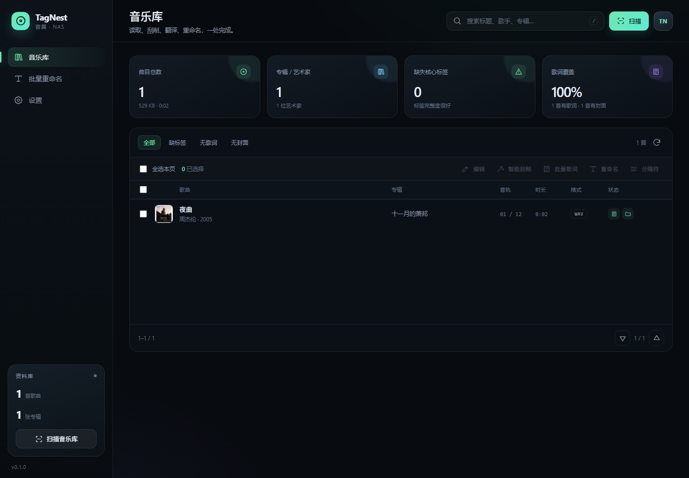
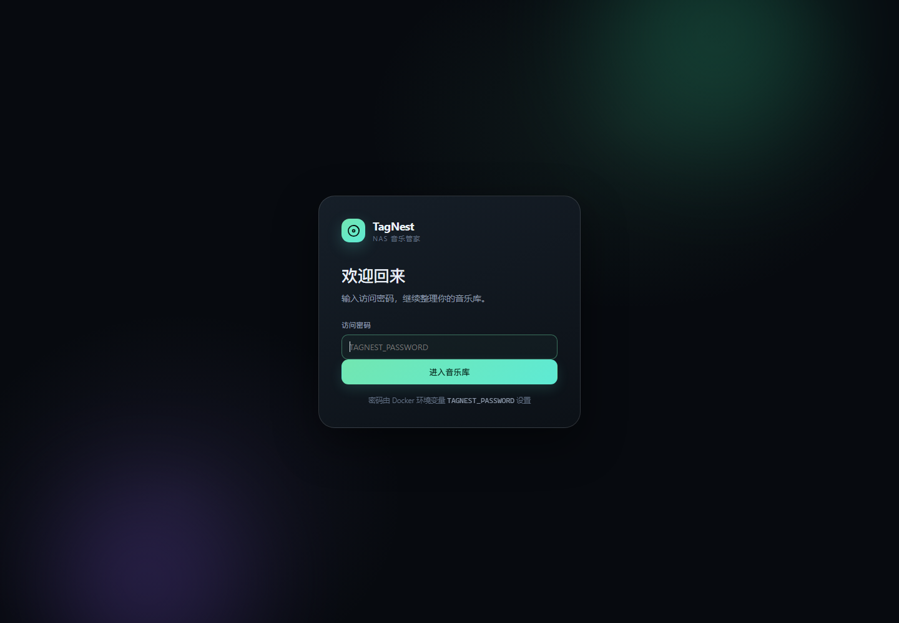
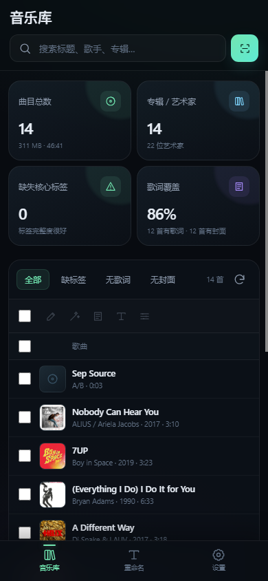
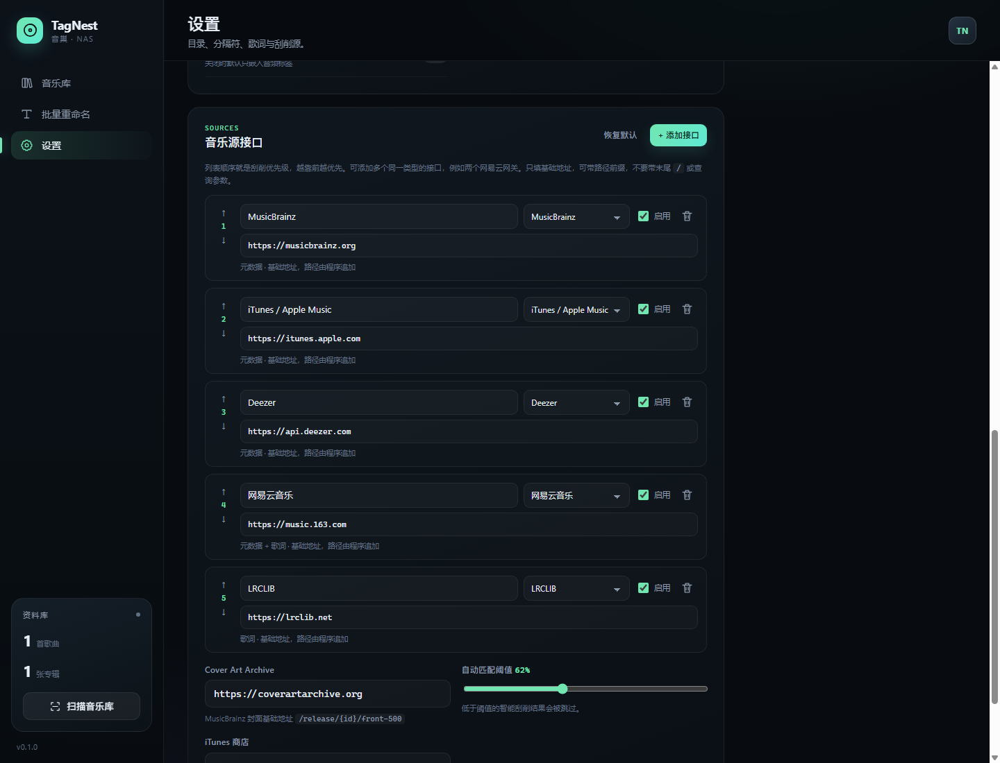

# TagNest · 音巢

面向 NAS 的轻量音乐标签管家：扫描音乐库、读写标签、从多个音乐源刮削、双语歌词、批量修改分隔符、按模板批量重命名。

- **单二进制**：Rust 编写，不依赖 Python、Node、ffmpeg、外部数据库
- **低占用**：空闲时约 15–30 MB 内存（2 个工作线程）
- **开箱即用**：原生 WebUI 已嵌入二进制，不需要前端构建
- **Docker 部署**：`docker compose up -d --build` 即可



## 功能

| 功能 | 说明 |
| --- | --- |
| 音乐库扫描 | 递归扫描多个 NAS 目录，支持 MP3 / FLAC / M4A / MP4 / OGG / Opus / WAV / AIFF / AAC / APE / WavPack / MPC，自动跳过 `@eaDir`、回收站等目录 |
| 标签读取与编辑 | 标题、艺术家（显示 ARTIST）、艺术家列表（多值 ARTISTS）、专辑艺术家、专辑、音轨/碟号、日期、流派、作曲、作词、注释、BPM、ISRC、唱片公司、目录号、MusicBrainz ID |
| 多源刮削 | MusicBrainz、iTunes / Apple Music、Deezer、网易云；支持单曲搜索与批量智能匹配，自动按标题、歌手、专辑、时长、ISRC 打分；不同源的多艺术家结果统一成一个分隔符 |
| 封面 | 从匹配源下载封面并写入标签，WebUI 内直接显示封面缓存 |
| 歌词 | LRCLIB + 网易云音乐；默认只嵌入音频标签，不新建 `.lrc`；原词与翻译可合并为双语歌词 |
| 刮削选项 | 智能刮削可只写入勾选的元数据字段，可选择是否更新封面；只改元数据、不生成歌词 |
| 任务停止 | 智能刮削、批量歌词、批量修改分隔符都带进度和停止按钮，当前歌曲处理完后终止 |
| 分隔符 | 识别分隔符默认包含 `; ； 、 | & , /`；艺术家列表、专辑艺术家、流派、作曲、作词可分别设置写入分隔符；刮削统一分隔符默认 `/` |
| 批量分隔符 | 只改写选中的多值字段；输出留空时使用各字段自己的默认分隔符 |
| 批量重命名 | `{artist}/{album}/{track:02d} - {title}` 等变量与格式说明，内置预设；`{artist}` 和 `{artists}` 的多艺术家连接符可单独自定义（默认 `, `），执行前预览冲突 |
| 音频预览 | WebUI 内嵌播放器，支持直接试听（流式传输） |
| 访问保护 | 可选 `TAGNEST_PASSWORD`，签名 Cookie 登录；不设置则作为局域网内网服务运行 |
| 移动端 | 底部导航、全宽列表、全屏编辑/刮削弹窗、刘海屏安全区；支持添加到手机主屏幕 |
| 音乐源接口 | 可添加、删除、重命名多个刮削接口，选择接口类型并填写 API 基础地址；列表顺序就是智能刮削/批量任务优先级 |
| 主题 | 翡翠、深海、暮光、纸白四种主题，设置中即时切换并保存 |

<p align="center"></p>

<p align="center"></p>

<p align="center"></p>

## 环境要求

### 部署（推荐）

只需要：

- Docker Engine 24+，Docker Compose v2
- 至少 128 MB 可用内存、1 个 CPU 核心
- 一个可写的 NAS 音乐目录（标签和歌词需要写回）
- 一个持久化数据目录（配置、索引、封面缓存）

**不需要**安装 Rust、Python、Node、ffmpeg、SQLite 或任何数据库。构建镜像由 Docker 自动完成。

### 本地开发（可选）

- Rust 1.85+（本项目在 1.99 上验证）
- C 编译器（`ring` 的构建依赖；Linux 安装 `build-essential`，macOS 安装 Xcode CLT）
- 不需要 Node；WebUI 是原生 HTML/CSS/JS，并通过 `include_str!` 嵌入二进制

## 快速开始

```bash
git clone <repo> tagnest
cd tagnest
cp .env.example .env        # 可选：设置密码和端口
# 编辑 docker-compose.yml，把 /volume1/music 改成你的 NAS 音乐目录
docker compose up -d --build
```

打开 `http://NAS_IP:8080`。

手机访问会自动切换为移动布局：底部导航、全宽歌曲列表、全屏编辑/刮削弹窗。  
iOS Safari 可「分享 → 添加到主屏幕」，Android Chrome 可「菜单 → 安装应用 / 添加到主屏幕」。

第一次进入后：

1. 在「设置 → 音乐目录」确认容器内路径（默认 `/music`），点保存。
2. 回到音乐库，点「扫描音乐库」。
3. 勾选歌曲后使用「编辑」「智能刮削」「批量歌词」「重命名」「分隔符」。

### docker-compose.yml 关键部分

```yaml
services:
  tagnest:
    build: .
    ports:
      - "8080:8080"
    environment:
      TAGNEST_PASSWORD: "换成你的密码"
      PUID: "1000"
      PGID: "1000"
    volumes:
      - ./data:/data
      - /volume1/music:/music   # 改成你的音乐目录
    restart: unless-stopped
```

### NAS 权限

容器默认以 PUID/PGID（默认 `1000:1000`）运行。请保证该用户在音乐目录有读写权限，否则只能读取、无法写入标签：

```bash
# 群晖示例：确认目录所有者
ls -ld /volume1/music
# 如果 NAS 用户是 1026:100
PUID=1026 PGID=100 docker compose up -d
```

`/data` 会自动 `chown` 给 PUID:PGID；音乐目录不会被递归改权限，避免误伤 NAS 共享。

### 端口 / 反向代理

默认监听 `0.0.0.0:8080`。放在 Nginx / Traefik 后面时：

- 将 `TAGNEST_PASSWORD` 设为强密码
- 建议启用 HTTPS（当前 Cookie 未强制 `Secure`，请只在可信网络或 HTTPS 反向代理后使用）
- 不要把 8080 直接暴露到公网；如需公网访问，请在反向代理层增加 TLS、限流和访问控制

## 环境变量

| 变量 | 默认值 | 说明 |
| --- | --- | --- |
| `TAGNEST_PORT` | `8080` | HTTP 端口 |
| `TAGNEST_BIND` | `0.0.0.0` | 监听地址 |
| `TAGNEST_DATA_DIR` | `/data`（容器）/ `data`（本地） | 配置、索引、封面、密钥 |
| `TAGNEST_MUSIC_DIRS` | `/music` | 逗号分隔的初始音乐目录；只在首次生成配置时使用 |
| `TAGNEST_PASSWORD` | 空 | 登录密码；空表示不启用登录 |
| `TAGNEST_THREADS` | `2` | Tokio 工作线程数；低配 NAS 保持 1–2 |
| `PUID` / `PGID` | `1000` / `1000` | 容器运行用户，影响写回文件的所有者 |
| `TZ` | `Asia/Shanghai` | 时区 |
| `TAGNEST_LOG` | `tagnest=info` | 日志级别，如 `tagnest=debug` |

## 数据目录与备份

`data/` 下：

```
data/
├── config.json       # 音乐目录、分隔符、歌词/刮削设置
├── library.redb      # 索引（可重建，删除后会重新扫描）
├── covers/           # 封面缓存（可重建）
└── secret.key        # 登录 Cookie 签名密钥（不要泄露）
```

备份 `config.json` 和 `secret.key` 即可保留设置与登录状态；索引可以随时重建。**音频标签和 `.lrc` 是写回音乐目录的，请自行做好 NAS 快照/备份。**

## 使用说明

### 分隔符

分隔符设置包括：

- **识别分隔符**：扫描时把 `A; B`、`A、B`、`A & B`、`A, B`、`A/B` 拆成多个值。默认 `; ； 、 | & , /`。如果艺术家名本身含 `/`（如 `AC/DC`），可以在设置中删除 `/`。
- **默认写入分隔符**：各字段没有单独设置时使用，默认 `; `。
- **字段写入分隔符**：艺术家列表、专辑艺术家、流派、作曲、作词可分别设置；留空使用默认值。
- **刮削统一分隔符**：不同音乐源的 `A & B`、`A / B`、`A、B` 会被拆开，再用这个分隔符写回，默认 `/`，两侧不加空格。可在设置中改成 `; `、` & ` 等。
- **重命名多艺术家连接符**：影响命名模板里的 `{artist}` 和 `{artists}`，默认 `, `；可在设置中设默认值，也可在重命名页面临时覆盖。`/` 等路径字符会被替换成 `_`。
- **ARTIST / ARTISTS**：`ARTIST` 是单个显示署名，`ARTISTS` 是艺术家列表；编辑器中分开编辑和写回，不再合并成一个字段。若文件只有 `ARTIST`，艺术家列表会保持为空，不会自动伪造 `ARTISTS`。旧索引会在启动时迁移，重新扫描后以文件中的实际标签为准。
- **批量分隔符**也支持 `ARTIST`（显示艺术家）和 `ALBUMARTIST`（专辑艺术家），会按输入分隔符拆分再用输出分隔符写回。

修改识别分隔符后需要重新扫描，旧文件里的多值字段才会被拆开。已经入库的歌曲可以用「批量修改分隔符」立即改写：

1. 勾选歌曲
2. 选「分隔符」
3. 勾选字段（艺术家显示、艺术家列表、专辑艺术家、流派、作曲、作词）
4. 设置输入分隔符；输出留空时使用各字段默认值
5. 应用

这会**实际重写音频标签**，建议先用一首歌验证。

### 主题与字号

设置 → 外观可以切换四种主题：

- 翡翠 · 默认
- 深海 · 蓝
- 暮光 · 紫
- 纸白 · 亮色

主题保存后所有设备共用。界面字号也已整体放大，移动端列表、设置项和弹窗同步调整。

### 命名模板

变量：

| 变量 | 含义 |
| --- | --- |
| `{artist}` | 艺术家（显示 ARTIST；多艺术家时用重命名连接符合并） |
| `{artists}` | 艺术家列表（ARTISTS，用重命名多艺术家连接符连接） |
| `{albumartist}` | 专辑艺术家 |
| `{album}` | 专辑 |
| `{title}` | 标题 |
| `{track}` / `{track:02d}` | 音轨号，可补零 |
| `{track_total}` | 音轨总数 |
| `{disc}` / `{disc_total}` | 碟号 / 碟总数 |
| `{year}` / `{date}` | 年份 / 日期 |
| `{genre}` / `{composer}` / `{label}` | 流派 / 作曲 / 唱片公司 |
| `{format}` / `{ext}` | 格式 / 原扩展名 |
| `{filename}` | 原文件名（不含扩展名） |

用 `/` 分目录。示例：

```text
{artist}/{album}/{track:02d} - {title}
{artist} - {title}
{album}/{disc}-{track:02d} {title}
```

执行前会校验：目标已存在、目标歌词已存在、多个目标冲突、路径越界。预检失败不会移动任何文件。

### 歌词

- LRCLIB 提供同步歌词，速度快、无需登录。
- 网易云音乐同时提供元数据、封面、中文歌词和翻译歌词，接口为公开 Web API，可能随服务调整。
- 元数据刮削默认只写标签；如果需要在同一流程中生成 `.lrc`，取消「只改元数据（不生成歌词）」即可。
- 勾选「双语歌词」后，翻译行会插在对应原文行后，使用相同时间戳。
- 歌词默认**只写入音频标签，不新建 `.lrc`**。需要文件时，在单曲/批量歌词里勾选「新建 .lrc 文件」，或在设置里把「默认新建 .lrc」打开。
- 不新建文件时必须嵌入音频标签；两者都关闭会被拒绝。
- 批量歌词默认阈值 0.5，匹配度过低会跳过，避免把别的歌歌词写进来。
- 批量歌词有独立进度窗口，可点击「停止」，当前歌曲完成后终止。

### 刮削源与优先级

设置 → 音乐源接口 是一个可增删的列表，每一行可以：

- 自定义接口名称
- 选择接口类型：MusicBrainz、iTunes、Deezer、网易云、LRCLIB
- 填写基础 API 地址
- 启用/停用
- 用上下箭头调整顺序
- 删除接口

列表顺序就是优先级：越靠前越优先。智能刮削、批量任务、单曲搜索的源列表会同步这里的配置。

| 接口类型 | 能力 | 默认基础地址 | 程序追加的路径 |
| --- | --- | --- | --- |
| MusicBrainz | 元数据、MBID、封面 | `https://musicbrainz.org` | `/ws/2/recording` |
| iTunes / Apple Music | 元数据、封面 | `https://itunes.apple.com` | `/search` |
| Deezer | 元数据、封面 | `https://api.deezer.com` | `/search` |
| LRCLIB | 同步歌词 | `https://lrclib.net` | `/api/get`、`/api/search`、`/api/get/{id}` |
| 网易云音乐 | 元数据、封面、歌词、翻译 | `https://music.163.com` | `/api/search/get`、`/api/song/detail`、`/api/song/lyric` |

Cover Art Archive 是 MusicBrainz 的封面基础地址，单独填写在列表下方。

批量「智能刮削」按标题 54%、歌手 27%、专辑 12%、时长 7% 打分，默认阈值 62%；低于阈值不会写入。开始前可以选择：

- 只写入哪些元数据字段
- 是否同时更新封面
- 是否只改元数据、不生成歌词

运行中可点击「停止」，当前歌曲处理完后终止。

例如把网易云指向自建网关：

```text
https://music.example.com
```

只填基础地址：可以带路径前缀（如 `https://proxy.example.com/netease`），但不要带末尾 `/` 或查询参数；接口路径由程序追加。界面的「查看完整接口路径」会列出实际请求路径；「恢复默认」可以一键还原。

可以添加多个同类型接口，例如两个网易云网关或两个 iTunes 镜像。当前自定义范围是**接口名称、类型和基础地址**，返回 JSON 结构需要与所选接口类型兼容；若要接入完全不同的数据结构，需要额外编写新的 provider 适配器。

## API（便于自动化）

所有 `/api/*` 接口（除 health/auth）都需要登录 Cookie（若设置了密码）。

```bash
# 登录
curl -c cookies.txt -H 'Content-Type: application/json' \
  -d '{"password":"your-password"}' http://localhost:8080/api/auth/login

# 扫描
curl -b cookies.txt -X POST -H 'Content-Type: application/json' -d '{}' \
  http://localhost:8080/api/scan

# 列表 / 搜索
curl -b cookies.txt 'http://localhost:8080/api/tracks?limit=20&q=夜曲'

# 修改标签
curl -b cookies.txt -X PATCH -H 'Content-Type: application/json' \
  -d '{"title":"夜曲","artist":"周杰伦","artists":["周杰伦"],"album":"十一月的萧邦"}' \
  http://localhost:8080/api/tracks/1

# 搜索刮削候选
curl -b cookies.txt 'http://localhost:8080/api/scrape/search?track_id=1'

# 批量歌词
curl -b cookies.txt -X POST -H 'Content-Type: application/json' \
  -d '{"ids":[1,2,3],"bilingual":true,"embed":true}' \
  http://localhost:8080/api/lyrics/batch
```

主要接口：

```
GET    /api/health
GET    /api/stats
GET    /api/tracks
GET    /api/tracks/{id}
PATCH  /api/tracks/{id}
POST   /api/scan
GET    /api/scan/status
POST   /api/scan/cancel
POST   /api/tracks/normalize
GET    /api/tracks/{id}/cover
GET    /api/tracks/{id}/stream
GET    /api/tracks/{id}/lyrics
POST   /api/lyrics/search
POST   /api/lyrics/apply
POST   /api/lyrics/batch
GET    /api/scrape/search
POST   /api/scrape/auto
POST   /api/scrape/apply
POST   /api/rename/preview
POST   /api/rename
GET    /api/settings
PUT    /api/settings
```

## 本地开发

```bash
# Linux/macOS 需要 C 编译器
cargo build --release
./target/release/tagnest --data ./data --music /path/to/music --port 8080
```

访问 `http://127.0.0.1:8080`。前端文件在 `web/`，修改后需要重新 `cargo build`，因为静态资源被编译进二进制。

测试：

```bash
cargo test
cargo clippy -- -D warnings   # 可选
```

## 设计说明

- **Rust + Axum**：异步 HTTP，低内存，单二进制。
- **Lofty**：统一读写 ID3v2 / Vorbis Comments / MP4 ILST / APE 标签，不调用 ffmpeg。
- **Redb**：纯 Rust 嵌入式 ACID 键值库，无需 SQLite 或数据库服务。
- **原生 WebUI**：无框架、无构建步骤，静态资源嵌入二进制。
- **封面缓存**：按需从标签提取到 `data/covers/`，避免每次请求解码音频。
- **索引可重建**：标签是唯一事实来源，索引损坏时删除 `library.redb` 重新扫描即可。

## 已知限制

- 只扫描本地已挂载路径；不会直接访问 SMB/WebDAV 地址，请先在 NAS/Docker 层挂载。
- 网易云歌词接口不是官方 API，若服务端调整可能失效；可只用 LRCLIB。
- MusicBrainz 有速率限制，批量智能刮削大量歌曲会较慢。
- 音频预览暂不支持 HTTP Range 精确拖动，但可以正常播放。
- 标签写入直接修改原文件；请保留 NAS 快照/备份，尤其是第一次批量操作前。
- 不支持 CUE 分轨、DSD/DSF、WMA；APE/WavPack 的写入能力取决于文件本身，建议先在副本上验证。

## License

MIT。第三方音乐源的元数据、封面和歌词版权归各自权利人所有，本项目仅提供检索与写入工具，请确保你的使用场景合法。
